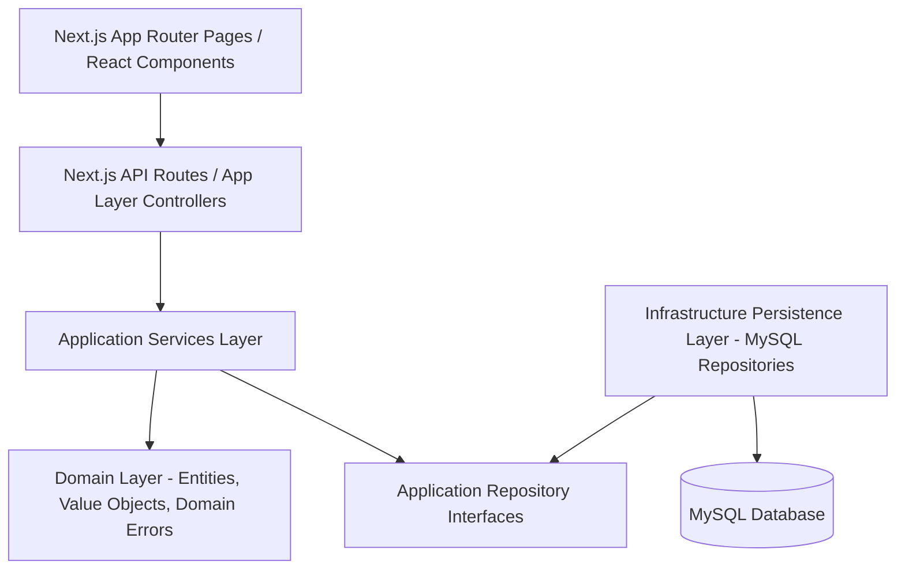
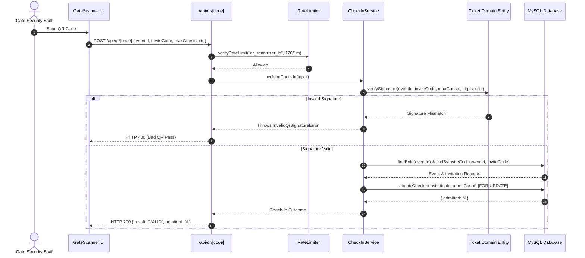

# Agafari Architecture Design Document (ADD)

**Document Version**: 2.0  
**Pattern**: Monolithic Layered Object-Oriented Domain-Driven Design (DDD)  
**Framework**: Next.js App Router + TypeScript + MySQL  

---

## 1. Architectural Layers & Structure

Agafari enforces strict layer boundaries to separate pure business rules from Next.js HTTP controllers and database persistence details.



### 1.1 Folder Hierarchy (`frontend/src/`)

```text
frontend/src/
├── domain/                      <- Pure TypeScript, zero external dependencies
│   ├── entities/                <- Plain classes: Event, Invitation, Ticket, Wish, MediaAsset
│   ├── value-objects/           <- LockWindow, Headcount
│   └── errors/                  <- DomainError and typed error subclasses
├── application/                 <- Use cases & business orchestrators
│   ├── services/                <- RsvpService, CheckInService, TemplateService, ModerationService, etc.
│   └── repositories/            <- Interface abstractions: IEventRepository, IInvitationRepository, etc.
├── infrastructure/              <- I/O & database implementation
│   ├── persistence/             <- MySQL implementations: MySqlEventRepository, MySqlInvitationRepository, etc.
│   ├── composition/             <- Service dependency injection composition root
│   └── dev/                     <- Mock data & local dev stubs
├── app/                         <- Thin Next.js HTTP controllers & pages
│   ├── api/                     <- Next.js Route Handlers (auth check -> call Application Service)
│   ├── admin/                   <- Admin dashboard pages
│   ├── organizer/               <- Organizer dashboard pages
│   ├── couple/                  <- Couple portal pages
│   ├── event/                   <- Guest invitation & feed pages
│   └── layout.tsx               <- Global app layout
├── components/                  <- Organized by feature domain
│   ├── gate/                    <- GateScanner camera QR reader
│   └── dashboard/               <- Management tables & metrics cards
├── lib/                         <- Utility modules
│   ├── auth.ts                  <- JWT & role verification
│   ├── db.ts                    <- mysql2 pool connection helper
│   ├── rateLimit.ts             <- Upstash/Memory sliding window rate limiter
│   └── errorTracking.ts         <- Telemetry & PII sanitizer
└── config/                      <- Environment & startup config
    └── env.ts                   <- Fail-fast production secret validator
```

---

## 2. Layer Responsibilities & Dependency Rules

1. **Domain Layer (`src/domain/`)**: Contains business entities and value objects. **Strict Rule**: Domain code MUST NOT import from `src/app`, `src/infrastructure`, `mysql2`, or any HTTP framework module.
2. **Application Layer (`src/application/`)**: Defines use-case service classes (`RsvpService`, `CheckInService`). Depends only on domain entities and repository interfaces.
3. **Infrastructure Layer (`src/infrastructure/`)**: Implements application interfaces using `mysql2` connection pool queries. Handles SQL transformations and atomic row locks.
4. **Presentation & HTTP Layer (`src/app/`)**: Thin Next.js API route handlers. Performs auth role checks via `requireRole()` / `checkEventAccess()`, delegates to application services, and maps domain errors to HTTP status codes.

---

## 3. System Architecture Diagram



---

## 4. Architectural Debt & Cleanup TODOs

- **PHP Legacy Scripts in `docs/`**: Historical PHP API scripts exist under `docs/agafari-backend-production-extracted/`. The active production engine is 100% Next.js Monolith. Legacy PHP files are retained for archival reference only.
