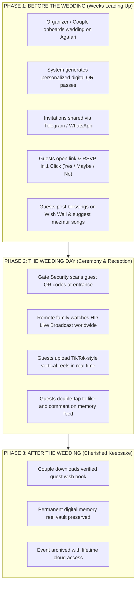
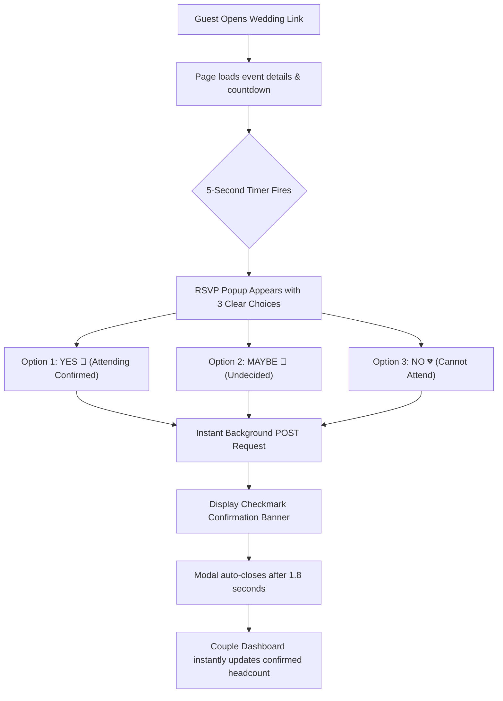
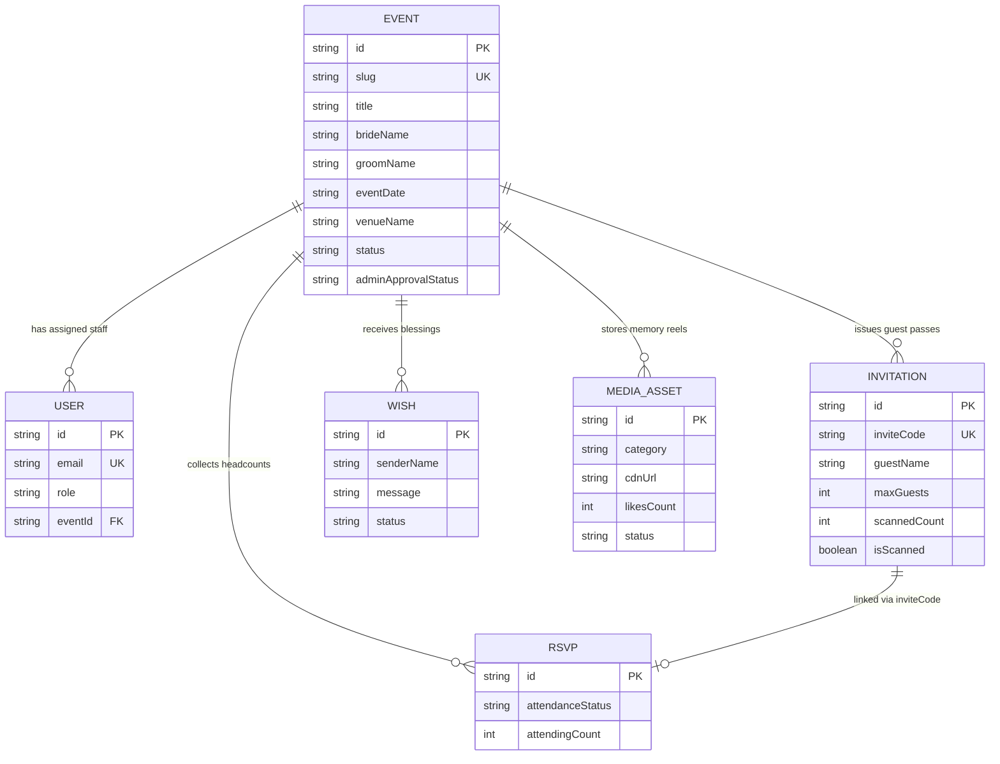
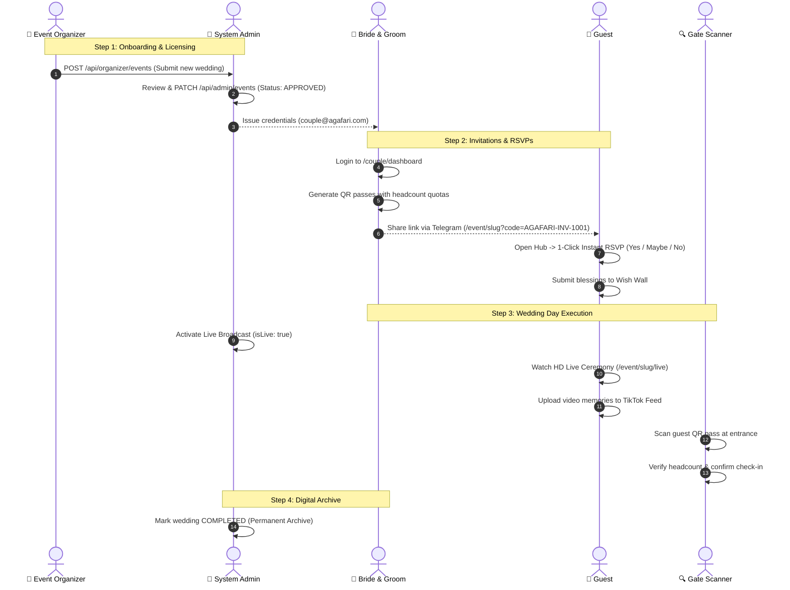

# 💍 AGAFARI (አጋፋሪ)
# Complete Master System Guide & Client Proposal
### The Premier All-in-One Digital Wedding Celebration Platform

---

> **Prepared by:** Hamelmal Creatives  
> **Platform Version:** 1.0.0 (Production Release)  
> **Publication Date:** September 2026  
> **Document Type:** Master System Guide, Technical Specification & User Manual  
> **Format:** Shareable Client & Engineering Edition  

---

## 📑 Master Table of Contents

1. [Executive Summary & Vision](#1-executive-summary--vision)
2. [The 4 Core Pillars of Agafari](#2-the-4-core-pillars-of-agafari)
3. [Architecture & Software Engineering (DDD 4-Layer)](#3-architecture--software-engineering-ddd-4-layer)
4. [Security, Authentication & Production Hardening](#4-security-authentication--production-hardening)
5. [Traditional Wedding vs. Agafari Platform](#5-traditional-wedding-vs-agafari-platform)
6. [The 3-Phase Wedding Lifecycle Journey](#6-the-3-phase-wedding-lifecycle-journey)
7. [Complete System Route Map & Visual Wireframes](#7-complete-system-route-map--visual-wireframes)
8. [1-Click Instant RSVP System](#8-1-click-instant-rsvp-system)
9. [Anti-Counterfeit QR Code Digital Pass & Gate Scanner](#9-anti-counterfeit-qr-code-digital-pass--gate-scanner)
10. [TikTok-Style Video Memory Feed](#10-tiktok-style-video-memory-feed)
11. [Global HD Live Broadcast Engine](#11-global-hd-live-broadcast-engine)
12. [User Roles & Granular RBAC Permissions Matrix](#12-user-roles--granular-rbac-permissions-matrix)
13. [Data Models & MySQL Database Schema](#13-data-models--mysql-database-schema)
14. [Complete REST API Reference (22 Endpoints)](#14-complete-rest-api-reference-22-endpoints)
15. [End-to-End System Sequence Diagram](#15-end-to-end-system-sequence-diagram)
16. [Bilingual English & Amharic Internationalization](#16-bilingual-english--amharic-internationalization)
17. [Packages, Deliverables & Service Tiers](#17-packages-deliverables--service-tiers)
18. [Verified Production Credentials & Live Demo URLs](#18-verified-production-credentials--live-demo-urls)

---

## 1. Executive Summary & Vision

**Agafari (አጋፋሪ)** is a high-performance digital wedding celebration platform specifically engineered for modern Ethiopian and Diaspora weddings. It digitizes the end-to-end wedding journey — from royal date announcements, guest RSVP tracking, anti-counterfeit QR invitations, door security scanning, broadcast-quality live streaming, to TikTok-style memory reels.

### Key Operational Challenges Solved
* **The Paper Problem**: Traditional paper invitation cards are expensive to print and physically deliver, easily lost, and offer zero attendance tracking.
* **The Catering Dilemma**: Couples typically waste 30% to 40% of their catering budget due to unpredictable guest turnout.
* **The Diaspora Disconnect**: Relatives in North America, Europe, and Australia frequently miss weddings due to distance or choppy video phone calls.
* **The Scattered Memories**: Guests film hundreds of authentic video moments on their personal phones, but couples rarely retrieve more than 15-20%.

**Agafari resolves all four challenges within a mobile-first, beautifully branded digital platform.**

---

## 2. The 4 Core Pillars of Agafari

```
┌─────────────────────────────────────────────────────────────────────────┐
│                           THE 4 CORE PILLARS                            │
├────────────────────┬────────────────────┬───────────────────────────────┤
│ 🎟️ DIGITAL RSVP    │ ⏳ CELEBRATION     │ 🎬 TIKTOK MEMORY │ 📡 GLOBAL  │
│    & QR GATE PASS  │    WEB HUB         │    FEED          │    LIVE    │
├────────────────────┼────────────────────┼───────────────────────────────┤
│ • Personalized QR  │ • Live Countdown   │ • Vertical Reels │ • HD Stream│
│ • 1-Click Popup    │ • Venue Google Map │ • Wishes & BTS   │ • Floating │
│ • 2-Sec Gate Scan  │ • Dress Code Guide │ • Double-Tap Like│   Reactions│
│ • Zero Food Waste  │ • Wish Wall        │ • Guest Upload   │ • Worldwide│
└────────────────────┴────────────────────┴───────────────────────────────┘
```

1. **Digital RSVP & QR Gate Pass**: Unique personalized QR invitations shared via Telegram or WhatsApp. Guests confirm attendance with 1 click, and door guards scan codes in under 2 seconds.
2. **Coming Soon Celebration Hub**: A luxury wedding website featuring a live countdown clock, venue directions, dress code guidelines, mezmur playlist requests, and an interactive Wish Wall.
3. **TikTok-Style Memory Feed**: A vertical snap-scroll video feed where guests and bridal party post backstage moments, video blessings, and dance practice reels.
4. **Global HD Live Broadcast**: HD ceremony streaming with real-time floating emoji reactions for remote family members worldwide.

---

## 3. Architecture & Software Engineering (DDD 4-Layer)

Agafari is built as a single, hardened Next.js App Router monolith backed by MySQL. The codebase strictly adheres to **Domain-Driven Design (DDD)** principles across 4 architectural layers:

```
┌─────────────────────────────────────────────────────────────────────────┐
│                     PRESENTATION LAYER (src/app/)                       │
│    Next.js 15 App Router • Server Components • Client Pages • UI       │
└────────────────────────────────────┬────────────────────────────────────┘
                                     │
┌────────────────────────────────────▼────────────────────────────────────┐
│                    APPLICATION LAYER (src/application/)                 │
│      Use Cases • Application Services • DTOs • Transaction Boundary    │
└────────────────────────────────────┬────────────────────────────────────┘
                                     │
┌────────────────────────────────────▼────────────────────────────────────┐
│                       DOMAIN LAYER (src/domain/)                        │
│    Domain Entities • Value Objects • Domain Events • Repository Interfaces│
└────────────────────────────────────▲────────────────────────────────────┘
                                     │
┌────────────────────────────────────┴────────────────────────────────────┐
│                  INFRASTRUCTURE LAYER (src/infrastructure/)             │
│    MySQL Pool • Upstash Redis Rate Limiting • Sentry Telemetry • Logger │
└─────────────────────────────────────────────────────────────────────────┘
```

---

## 4. Security, Authentication & Production Hardening

* **JWT Cookie Authentication**: Cryptographic HMAC SHA-256 tokens stored in secure, HttpOnly, SameSite cookies with automatic expiration.
* **Salted Password Hashing**: PBKDF2-SHA512 algorithm with 16-byte random cryptographic salts.
* **Dual-Layer Rate Limiting**: Upstash Redis rate limiting with an in-memory token bucket fallback protecting all API routes against brute force attacks.
* **Sentry Telemetry & PII Masking**: Real-time error tracking with strict masking of sensitive fields (passwords, emails, phone numbers).
* **Strict Schema Validation**: Zod environment variable validation ensuring all credentials and keys exist prior to runtime.

---

## 5. Traditional Wedding vs. Agafari Platform

| Dimension | Traditional Ethiopian Wedding | With Agafari Digital Platform |
|---|---|---|
| **Invitations** | Expensive physical printing; manual hand delivery; lost cards | Instant personalized digital QR cards shared via Telegram, WhatsApp, or SMS |
| **RSVP Headcount** | Guesswork; 30-40% seat and catering waste | Real-time exact guest attendance with zero-friction 1-Click RSVP |
| **Gate Security** | Slow paper guest lists; long queues; gate crashing | 2-second QR scan; anti-counterfeit duplicate entry warning |
| **Diaspora Family** | Unstable personal phone video calls | Broadcast HD live stream with floating heart and cheer reactions |
| **Guest Videos** | Scattered on 100+ guest phones; couple loses 80% | Centralized TikTok-style vertical video reel vault |
| **Language Support** | Fixed in single language | Instant zero-reload bilingual toggle (English & Amharic with Ethiopic fonts) |

---

## 6. The 3-Phase Wedding Lifecycle Journey



---

## 7. Complete System Route Map & Visual Wireframes

| # | Route | Page Title | Access | Purpose |
|---|---|---|---|---|
| 1 | `/` | **Landing Page** | Public | Marketing homepage with features, packages, and live interactive demo simulator |
| 2 | `/event/[slug]` | **Celebration Hub** | Public | Central wedding destination: countdown, venue, QR pass, wish wall, and 1-Click RSVP |
| 3 | `/event/[slug]/feed` | **TikTok Memory Feed** | Public | Vertical snap-scroll video reel feed with Wishes, BTS, and Live tabs |
| 4 | `/event/[slug]/live` | **Live Stream Page** | Public | YouTube Live embed with viewer count and floating reaction emojis |
| 5 | `/event/[slug]/gallery`| **Photo & Media Gallery**| Public | Photo gallery showcase for ceremony and reception pictures |
| 6 | `/event/[slug]/program`| **Event Itinerary** | Public | Wedding schedule breakdown (Church, Hall entrance, Cake cutting, Melse) |
| 7 | `/event/[slug]/scanner`| **Event Gate Scanner**| `GATE_SCANNER` | Dedicated scanner interface bound to specific wedding |
| 8 | `/scanner` | **Global Gate Scanner** | `GATE_SCANNER` | Mobile door verification scanner for security guards |
| 9 | `/couple/login` | **Couple Login** | Public | Authentication portal for the bride and groom |
| 10| `/couple/dashboard` | **Couple Dashboard** | `BRIDE_GROOM` | Private control center for guest list, QR generator, moderation, and staff |
| 11| `/organizer/login` | **Organizer Login** | Public | Login portal for wedding planning agencies |
| 12| `/organizer/dashboard`| **Organizer Dashboard**| `EVENT_ORGANIZER` | Multi-wedding onboarding, client credential management, and approvals |
| 13| `/admin/login` | **System Admin Login** | Public | Master portal login for system administrators |
| 14| `/admin/dashboard` | **System Admin Control**| `SYSTEM_ADMIN` | Platform control: event licensing, live toggle, user management, CMS |

---

## 8. 1-Click Instant RSVP System



---

## 9. Anti-Counterfeit QR Code Digital Pass & Gate Scanner

```
┌─────────────────────────────────────────────────────────────┐
│                 HOW THE QR PASS SYSTEM WORKS                │
├─────────────────────────────────────────────────────────────┤
│                                                             │
│  STEP 1: Couple generates invite:                           │
│  "Solomon Kebede - Quota: 2 Persons"                        │
│                                                             │
│  STEP 2: System generates unique code:                      │
│  AGAFARI-INV-1001  ➔  QR Code Image                         │
│                                                             │
│  STEP 3: Guest receives personal link via Telegram:         │
│  http://agafari.com/event/slug?code=AGAFARI-INV-1001        │
│                                                             │
│  STEP 4: At venue door, security scans QR code:             │
│  • Scan 1 (4:00 PM) ➔ ✅ VALID (2 Guests Checked In)        │
│  • Scan 2 (4:15 PM) ➔ ⚠️ WARNING: Already Scanned at 4:00 PM│
│                                                             │
└─────────────────────────────────────────────────────────────┘
```

---

## 10. TikTok-Style Video Memory Feed

* **Snap-Scroll Experience**: Mobile-optimized vertical video reels with 60fps swipe transitions.
* **3 Dedicated Categories**:
  1. 💌 **Wishes**: Heartfelt video blessings recorded by relatives and diaspora family.
  2. 💃 **Behind the Scenes**: Groomsmen Eskista dance rehearsals, hair and makeup, candid moments.
  3. 🔴 **Live Clips**: Highlights from church ceremony and hall entrance.
* **Engagement & Upload**: Double-tap screen heart burst, slide-up comments drawer, and 1-tap mobile upload modal.

---

## 11. Global HD Live Broadcast Engine

* **Worldwide Reach**: Responsive YouTube Live player running seamlessly across mobile devices, tablets, and smart TVs.
* **Interactive Reactions**: Viewers tap floating reaction buttons (❤️, 🥂, 🎉, 🔥) that float animated emojis across the stream.
* **Concurrent Viewer Counter**: Real-time ticker displaying active viewers celebrating around the globe.

---

## 12. User Roles & Granular RBAC Permissions Matrix

| Capability | Guest | Gate Scanner | Live Streamer | Bride & Groom | Event Organizer | System Admin |
|---|:---:|:---:|:---:|:---:|:---:|:---:|
| View Celebration Hub | ✅ | ✅ | ✅ | ✅ | ✅ | ✅ |
| Submit 1-Click RSVP | ✅ | ✅ | ✅ | ✅ | ✅ | ✅ |
| Post Wishes & Songs | ✅ | ✅ | ✅ | ✅ | ✅ | ✅ |
| Upload Video to Feed | ✅ | ✅ | ✅ | ✅ | ✅ | ✅ |
| Scan QR Code at Gate | ❌ | ✅ | ❌ | ❌ | ❌ | ✅ |
| Broadcast Live Stream | ❌ | ❌ | ✅ | ❌ | ❌ | ✅ |
| Manage Invitations & QR | ❌ | ❌ | ❌ | ✅ | ✅ | ✅ |
| Moderate Wishes & Media | ❌ | ❌ | ❌ | ✅ | ✅ | ✅ |
| Assign Field Team | ❌ | ❌ | ❌ | ✅ | ✅ | ✅ |
| Onboard New Weddings | ❌ | ❌ | ❌ | ❌ | ✅ | ✅ |
| Approve / License Weddings | ❌ | ❌ | ❌ | ❌ | ❌ | ✅ |
| Manage All User Accounts | ❌ | ❌ | ❌ | ❌ | ❌ | ✅ |

---

## 13. Data Models & MySQL Database Schema



---

## 14. Complete REST API Reference (22 Endpoints)

| Method | Endpoint | Description | Access Required |
|---|---|---|---|
| `POST` | `/api/auth/login` | Authenticate user; issue JWT cookie | Public |
| `GET` | `/api/auth/me` | Fetch active user session profile | Authenticated |
| `GET` | `/api/events/[slug]` | Fetch public event metadata & venue info | Public |
| `PUT` | `/api/events/[slug]` | Update wedding details (venue, date, dress code) | Couple / Admin |
| `GET` | `/api/events/[slug]/wishes` | Fetch approved blessings for Wish Wall | Public |
| `POST` | `/api/events/[slug]/wishes` | Submit a new text or video blessing | Public |
| `GET` | `/api/events/[slug]/media` | Fetch approved TikTok memory reels | Public |
| `POST` | `/api/events/[slug]/media` | Upload a new video memory | Public |
| `POST` | `/api/events/[slug]/rsvp` | 1-Click instant RSVP submission | Public |
| `GET` | `/api/events/[slug]/invitations`| Fetch all guest invitations & scan records | Couple / Org |
| `POST` | `/api/events/[slug]/invitations`| Generate a unique QR pass with headcount quota | Couple / Org |
| `GET` | `/api/events/[slug]/team` | Fetch assigned field staff members | Couple / Org |
| `POST` | `/api/events/[slug]/team` | Assign a new Live Streamer or Gate Scanner | Couple / Org |
| `DELETE`| `/api/events/[slug]/team` | Remove an assigned staff member | Couple / Org |
| `GET` | `/api/events/[slug]/quota` | Fetch current headcount quota usage | Couple / Org |
| `GET` | `/api/organizer/events` | List agency client weddings with credentials | Organizer |
| `POST` | `/api/organizer/events` | Onboard a new wedding for admin review | Organizer |
| `GET` | `/api/admin/events` | Master list of all platform weddings | System Admin |
| `PATCH` | `/api/admin/events` | Approve/reject events; toggle live broadcast | System Admin |
| `GET` | `/api/admin/users` | List all platform user accounts | System Admin |
| `POST` | `/api/admin/users` | Create user account with assigned role | System Admin |
| `GET` | `/api/templates` | List active wedding design templates | Public |

---

## 15. End-to-End System Sequence Diagram



---

## 16. Bilingual English & Amharic Internationalization

* **Instant Language Switcher**: 1-tap toggle between English and Amharic without refreshing the page.
* **Contextual Localization**: Every UI string, button, modal, error message, and email template translated.
* **Royal Ethiopic Web Fonts**: Custom Google Fonts integrated for authentic Ethiopian typography:
  * **Noto Serif Ethiopic**: Used for headings, titles, and royal banners.
  * **Noto Sans Ethiopic**: Used for body copy, labels, and forms.

---

## 17. Packages, Deliverables & Service Tiers

```
┌─────────────────────────┬─────────────────────────┬─────────────────────────┐
│     SILVER PACKAGE      │      GOLD PACKAGE       │    DIAMOND PACKAGE      │
│     (Essential Digital) │   (Full Experience)     │   (Royal VIP Luxury)    │
├─────────────────────────┼─────────────────────────┼─────────────────────────┤
│ • Coming Soon Web Hub   │ • Everything in Silver  │ • Everything in Gold    │
│ • Live Countdown Clock  │ • TikTok Memory Feed    │ • Dedicated HD Live Stream│
│ • 1-Click RSVP System   │ • Guest Video Uploads   │ • Custom Wedding Domain │
│ • Up to 200 QR Passes   │ • Up to 500 QR Passes   │ • Unlimited QR Passes   │
│ • Interactive Wish Wall │ • Gate Scanner Account  │ • 3 Gate Scanner Staff  │
│ • Couple Dashboard      │ • Mezmur Playlist Hub   │ • Lifetime Video Vault  │
│ • 3 Months Hosting      │ • 6 Months Hosting      │ • 1 Year VIP Support    │
└─────────────────────────┴─────────────────────────┴─────────────────────────┘
```

---

## 18. Verified Production Credentials & Live Demo URLs

### Database Verified Test Accounts:

| Role | Portal URL | Verified Email | Password |
|---|---|---|---|
| **System Super Admin** | `/admin/login` | `admin@agafari.com` | `Admin123!` |
| **System Admin (Secondary)** | `/admin/login` | `admin@hamelmal.com` | `admin123` |
| **Event Organizer Agency** | `/organizer/login` | `organizer@agafari.com` | `Organizer123!` / `admin123` |
| **Bride & Groom (Couple)** | `/couple/login` | `couple@agafari.com` | `Couple123!` / `admin123` |
| **Gate Security Guard** | `/event/aynalem-and-birhanu-mtxgppv9/scanner` | `gate@agafari.com` | `admin123` |

### Key Demonstration Web Routes (Server: `http://localhost:3000`):
* **Public Marketing Homepage**: `http://localhost:3000/`
* **Celebration Web Hub**: `http://localhost:3000/event/aynalem-and-birhanu-mtxgppv9`
* **Personalized QR Invitation**: `http://localhost:3000/event/aynalem-and-birhanu-mtxgppv9?code=AGAFARI-INV-1001`
* **TikTok Memory Feed**: `http://localhost:3000/event/aynalem-and-birhanu-mtxgppv9/feed`
* **HD Live Broadcast**: `http://localhost:3000/event/aynalem-and-birhanu-mtxgppv9/live`
* **Global QR Gate Security Scanner**: `http://localhost:3000/scanner`
* **Shareable System Guide Webpage**: `http://localhost:3000/shareable-guide.html`

---

*© 2026 Hamelmal Creatives. All rights reserved. Agafari Digital Wedding Celebration Platform.*
