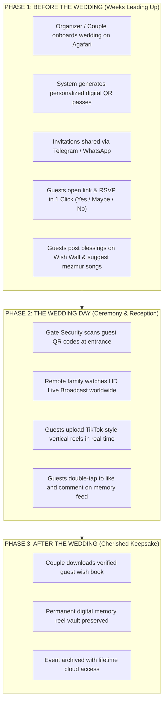
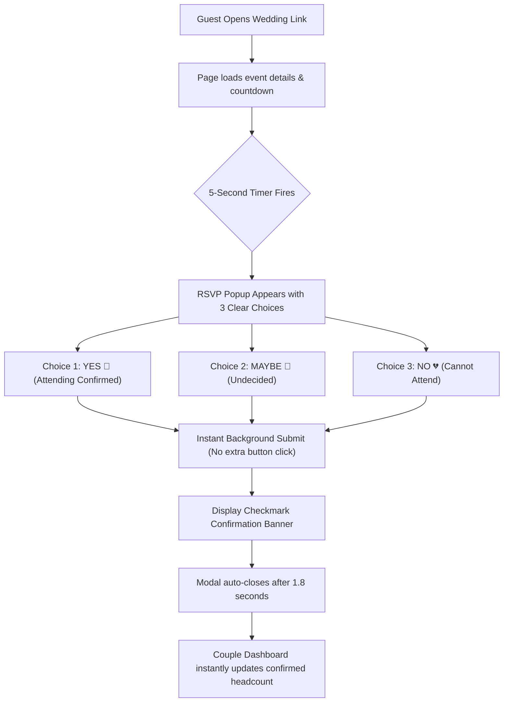
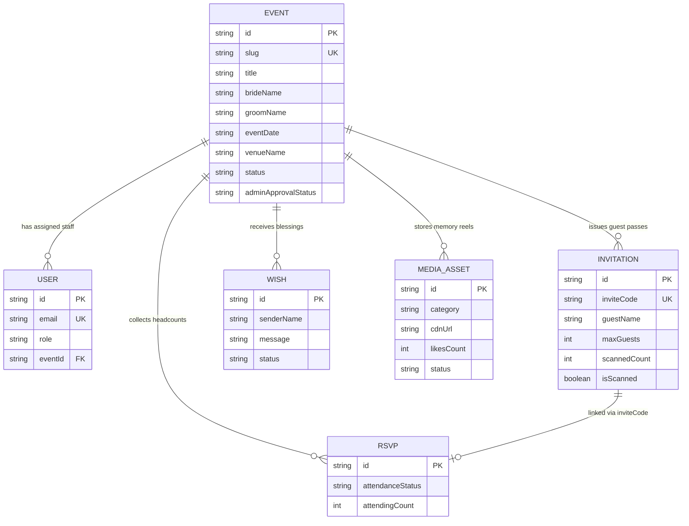
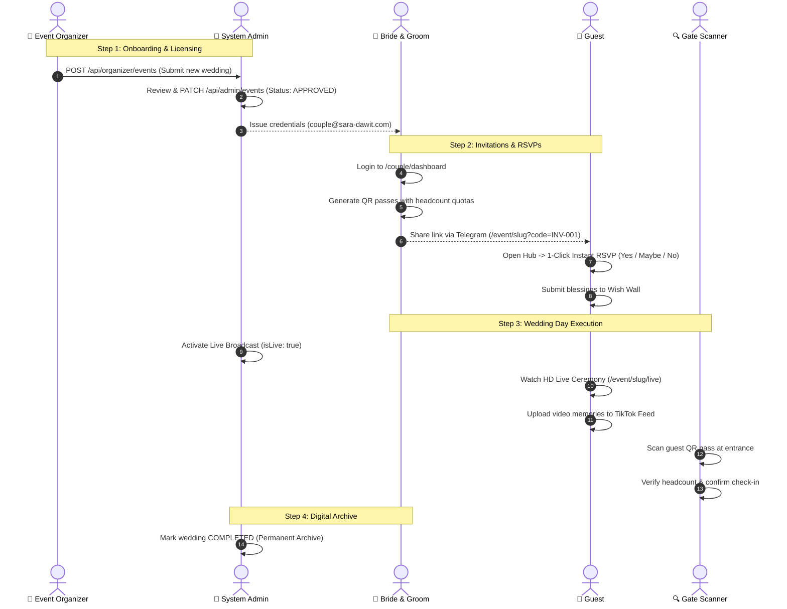

# 💍 AGAFARI (አጋፋሪ)
# Complete Master System Guide & Client Proposal
### The All-in-One Digital Wedding Celebration Platform

---

> **Prepared by:** Hamelmal Creatives  
> **Platform Version:** 1.0.0  
> **Publication Date:** August 2026  
> **Document Type:** Master Proposal, System Specification & User Manual  
> **Format:** Shareable Client & Technical Edition  

---

## 📑 Master Table of Contents

1. [Executive Summary & Vision](#1-executive-summary--vision)
2. [The 4 Core Pillars of Agafari](#2-the-4-core-pillars-of-agafari)
3. [Traditional Wedding vs. Agafari Platform](#3-traditional-wedding-vs-agafari-platform)
4. [The 3-Phase Wedding Lifecycle Journey](#4-the-3-phase-wedding-lifecycle-journey)
5. [Complete 12-Page Visual Walkthrough](#5-complete-12-page-visual-walkthrough)
6. [1-Click Instant RSVP System](#6-1-click-instant-rsvp-system)
7. [QR Code Digital Pass & Gate Scanner System](#7-qr-code-digital-pass--gate-scanner-system)
8. [TikTok-Style Video Memory Feed](#8-tiktok-style-video-memory-feed)
9. [Global HD Live Streaming System](#9-global-hd-live-streaming-system)
10. [User Roles & Permissions Matrix](#10-user-roles--permissions-matrix)
11. [Data Models & Schema Architecture](#11-data-models--schema-architecture)
12. [Complete REST API Reference (16+ Endpoints)](#12-complete-rest-api-reference-16-endpoints)
13. [End-to-End System Sequence Diagram](#13-end-to-end-system-sequence-diagram)
14. [Security, Authentication & Data Protection](#14-security-authentication--data-protection)
15. [Internationalization (Bilingual English & Amharic)](#15-internationalization-bilingual-english--amharic)
16. [Packages, Deliverables & Pricing](#16-packages-deliverables--pricing)
17. [Demo Testing Accounts & Live URLs](#17-demo-testing-accounts--live-urls)

---

## 1. Executive Summary & Vision

**Agafari** is an all-in-one digital wedding platform custom-built for modern Ethiopian and Diaspora weddings. It digitizes the entire wedding experience — from the moment the couple announces their date, through RSVP management, digital QR invitations, gate entry verification, live ceremony broadcasting, and guest video memories.

### Why Agafari Was Created
* **The Paper Problem**: Traditional paper invitation cards cost thousands of Birr to print and distribute, are easily lost, and provide zero visibility into actual guest attendance.
* **The Catering Dilemma**: Couples typically overspend by 30% to 40% on catering due to unpredictable guest numbers.
* **The Diaspora Disconnect**: Family and loved ones in North America, Europe, and the Middle East often miss weddings due to distance or poor video calls.
* **The Lost Memories**: Guests take hundreds of beautiful videos and photos on their personal phones, but the couple rarely receives more than 20% of them.

**Agafari solves all four challenges in a single, mobile-first, beautifully branded web platform.**

---

## 2. The 4 Core Pillars of Agafari

```
┌─────────────────────────────────────────────────────────────────────────┐
│                           THE 4 CORE PILLARS                            │
├────────────────────┬────────────────────┬───────────────────────────────┤
│ 🎟️ DIGITAL RSVP    │ ⏳ CELEBRATION     │ 🎬 TIKTOK MEMORY │ 📡 GLOBAL  │
│    & QR GATE PASS  │    WEB HUB         │    FEED          │    LIVE    │
├────────────────────┼────────────────────┼───────────────────────────────┤
│ • Personalized QR  │ • Live Countdown   │ • Vertical Reels │ • HD Stream│
│ • 1-Click Popup    │ • Venue Google Map │ • Wishes & BTS   │ • Floating │
│ • 2-Sec Gate Scan  │ • Dress Code Guide │ • Double-Tap Like│   Reactions│
│ • Zero Food Waste  │ • Wish Wall        │ • Guest Upload   │ • Worldwide│
└────────────────────┴────────────────────┴───────────────────────────────┘
```

1. **Digital RSVP & QR Gate Pass**: Unique personalized QR invitations sent via Telegram or WhatsApp. Guests RSVP in one click, and gate security scans passes in under 2 seconds.
2. **Coming Soon Celebration Hub**: A luxury wedding website featuring a real-time countdown clock, venue directions, dress code guidelines, and an interactive Blessing Wall.
3. **TikTok-Style Memory Feed**: A vertical snap-scroll video feed where bridal party and guests upload authentic backstage moments, wishes, and dance practice videos.
4. **Global HD Live Streaming**: Broadcast-quality ceremony streaming with real-time floating emoji reactions for remote family members worldwide.

---

## 3. Traditional Wedding vs. Agafari Platform

| Dimension | Traditional Wedding | With Agafari Platform |
|---|---|---|
| **Invitations** | Expensive physical printing; manual hand delivery; lost cards | Instant personalized digital QR cards shared via Telegram, WhatsApp, or SMS |
| **RSVP Headcount** | Guesswork; 30-40% seat and catering waste | Real-time exact guest attendance with 1-Click RSVP |
| **Gate Security** | Slow paper guest lists; long queues; gate crashing | 2-second QR scan; anti-counterfeit duplicate entry warning |
| **Diaspora Family** | Unstable personal phone video calls | Broadcast HD live stream with floating heart and cheer reactions |
| **Guest Videos** | Scattered on 100+ guest phones; couple loses 80% | Centralized TikTok-style vertical video reel vault |
| **Language Support** | Fixed in single language | Instant bilingual toggle (English & Amharic with royal Ethiopic fonts) |

---

## 4. The 3-Phase Wedding Lifecycle Journey



---

## 5. Complete 12-Page Visual Walkthrough

### Summary Table of All 12 Pages

| # | Route | Page Title | User Access | Purpose |
|---|---|---|---|---|
| 1 | `/` | **Landing Page** | Public | Marketing homepage with features, packages, and live interactive demo simulator |
| 2 | `/event/[slug]` | **Coming Soon Hub** | Public (Guest) | Central wedding destination: countdown, venue, QR pass, wish wall, and 1-Click RSVP |
| 3 | `/event/[slug]/feed` | **TikTok Memory Feed** | Public (Guest) | Vertical snap-scroll video reel feed with Wishes, BTS, and Live tabs |
| 4 | `/event/[slug]/live` | **Live Stream Page** | Public (Guest) | YouTube Live embed with viewer count and floating reaction emojis |
| 5 | `/event/[slug]/invitation`| **Invitation Redirect** | Public (Guest) | Legacy route redirecting seamlessly to the main Celebration Hub |
| 6 | `/couple/login` | **Couple Login** | Public | Dedicated authentication portal for the bride and groom |
| 7 | `/couple/dashboard` | **Couple Dashboard** | `BRIDE_GROOM` | Private control center for guest list, QR generator, moderation, and staff |
| 8 | `/organizer/login` | **Organizer Login** | Public | Login portal for wedding planning agencies |
| 9 | `/organizer/dashboard` | **Organizer Dashboard** | `EVENT_ORGANIZER` | Multi-wedding onboarding, client credential management, and approvals |
| 10 | `/admin/login` | **System Admin Login** | Public | Master portal login for Hamelmal administrators |
| 11 | `/admin/dashboard` | **System Admin Dashboard**| `SYSTEM_ADMIN` | Master platform control: event licensing, live toggle, user management, media vault |
| 12 | `/scanner` | **QR Gate Scanner** | `GATE_SCANNER` | Mobile gate verification tool for security guards to scan and check in guests |

---

### Detailed Page Breakdowns

#### Page 1: Marketing Landing Page (`/`)
* **Target Audience**: Prospective couples, wedding planners, and corporate event organizers.
* **Key Sections**:
  * **Hero Header**: Luxury Ethiopian gold branding, bilingual toggle (EN / አማ), and primary call-to-action button.
  * **Feature Showcase**: 3 interactive cards demonstrating the Live Countdown, TikTok Feed, and QR Digital Pass.
  * **Interactive Product Simulator**: Live tabbed interface allowing clients to preview all 5 product screens on the spot.
  * **Packages & Pricing**: Silver, Gold, and Diamond tiers with feature comparison.
  * **Mobile Scroll-Spy Navigation**: Floating bottom bar on mobile devices highlighting the current section with a golden pill.

---

#### Page 2: Coming Soon Celebration Hub (`/event/[slug]`)
* **Target Audience**: All invited wedding guests.
* **Layout Structure**:
  1. **Couple Hero Banner**: High-resolution cover photo, couple names, and welcome message.
  2. **Live Countdown Clock**: Real-time ticker displaying Days, Hours, Minutes, and Seconds remaining.
  3. **Event Schedule & Location Cards**: Date, Time, Venue name, Physical Address, Google Maps link, and Dress Code.
  4. **Personalized QR Invitation Pass**: Guest name, table number, headcount quota, and one-tap Telegram/WhatsApp share button.
  5. **Interactive Wish Wall**: Real-time display of text and video blessings submitted by guests.
  6. **Mezmur & Song Recommendation Hub**: Form for guests to suggest choir tracks or reception dance songs.
  7. **1-Click Instant RSVP Popup**: Auto-triggers 5 seconds after page load.

---

#### Page 3: TikTok-Style Memory Feed (`/event/[slug]/feed`)
* **Target Audience**: Wedding attendees and bridal party.
* **Layout Structure**:
  * **Top Navigation Tabs**:
    * 🔴 **Live**: Stream highlights and entrance footage.
    * 💌 **Wishes**: Video blessings recorded by friends and family.
    * 💃 **Behind the Scenes**: Makeup prep, groomsmen rehearsals, and candid moments.
  * **Vertical Full-Screen Reels**: Snap-scrolling video feed with auto-play and loop.
  * **Double-Tap Interaction**: Heart burst animation on double tap.
  * **Slide-Up Comments Drawer**: Read and post real-time comments.
  * **Video Upload Modal**: Guests select a category, write a caption, and publish directly to the feed.

---

#### Page 4: Live Ceremony Stream (`/event/[slug]/live`)
* **Target Audience**: Remote diaspora family and friends.
* **Layout Structure**:
  * **HD Video Embed**: Responsive YouTube Live broadcast player.
  * **Live Status Indicator**: Pulsing red "LIVE" badge showing concurrent viewer counts.
  * **Interactive Floating Reactions**: Tap ❤️, 🥂, 🎉, or 🔥 to float animated emojis across the screen.

---

#### Page 5: QR Gate Scanner (`/scanner`)
* **Target Audience**: Venue security guards, ushers, and gate door staff.
* **Layout Structure**:
  * **Code Input / Camera Reader**: Enter or scan invitation codes (e.g. `INV-SD2026-001`).
  * **Verification Result Screen**:
    * 🟢 **VALID PASS**: Displays guest name, table assignment, and allowed headcount quota with 1-tap "Check In" button.
    * 🟡 **ALREADY SCANNED WARNING**: Displays red alert with previous check-in timestamp to prevent screenshot sharing.
    * 🔴 **INVALID PASS**: Rejects unauthorized codes.

---

#### Page 6: Couple Management Dashboard (`/couple/dashboard`)
* **Target Audience**: The Bride & Groom.
* **Layout Structure**:
  * **Overview Analytics**: Total invitations, confirmed attendees, pending responses, and media count.
  * **Guest & QR Pass Generator**: Add guests, set headcount quota (e.g. 1 or 2 persons), and generate unique shareable links.
  * **Wish Wall Moderation**: Approve or reject guest messages before public display.
  * **Media Feed Moderation**: Approve, reject, or permanently delete uploaded videos.
  * **Staff Management**: Create login credentials for gate security guards and videographers.
  * **Event Settings Editor**: Update venue, date, dress code, and cover photo anytime.

---

#### Page 7: Organizer Dashboard (`/organizer/dashboard`)
* **Target Audience**: Wedding Planning Agencies.
* **Layout Structure**:
  * **Multi-Event Portfolio**: Manage multiple client weddings in one dashboard.
  * **1-Click Wedding Onboarding**: Register new couple, date, venue, and package tier.
  * **Client Credential Handover**: View and copy login credentials for newly onboarded couples.
  * **Approval Status Tracker**: Track admin licensing approvals (`PENDING`, `APPROVED`, `REJECTED`).

---

#### Page 8: Master System Admin Dashboard (`/admin/dashboard`)
* **Target Audience**: Hamelmal Creatives Platform Administrators.
* **Layout Structure**:
  * **Platform Overview**: Global statistics across all registered weddings, users, and media assets.
  * **Wedding Licensing Hub**: Approve or reject newly registered weddings, change event statuses (`DRAFT`, `COMING_SOON`, `LIVE`, `COMPLETED`, `ARCHIVED`), and toggle live broadcasts.
  * **User Management Hub**: Create, edit, reset passwords, or delete any platform account.
  * **Global Media Vault**: Platform-wide moderation to review and manage all media uploads.

---

## 6. 1-Click Instant RSVP System

The RSVP system is engineered for zero friction:



### RSVP Options:
1. 🥂 **YES**: Automatically records attendance for the guest's allotted quota.
2. 🤔 **MAYBE**: Records an undecided response so the couple can follow up before final catering locks.
3. 💔 **NO**: Politely records non-attendance and invites the guest to send their blessings on the Wish Wall.

---

## 7. QR Code Digital Pass & Gate Scanner System

```
┌─────────────────────────────────────────────────────────────┐
│                 HOW THE QR PASS SYSTEM WORKS                │
├─────────────────────────────────────────────────────────────┤
│                                                             │
│  STEP 1: Couple generates invite:                           │
│  "Dr. Michael Tesfaye - Quota: 2 Persons"                   │
│                                                             │
│  STEP 2: System generates unique code:                      │
│  INV-SD2026-002  ➔  QR Code Image                           │
│                                                             │
│  STEP 3: Guest receives personal link via Telegram:         │
│  http://agafari.com/event/sara-dawit?code=INV-SD2026-002    │
│                                                             │
│  STEP 4: At venue door, security scans QR code:             │
│  • Scan 1 (4:00 PM) ➔ ✅ VALID (2 Guests Checked In)        │
│  • Scan 2 (4:15 PM) ➔ ⚠️ WARNING: Already Scanned at 4:00 PM│
│                                                             │
└─────────────────────────────────────────────────────────────┘
```

---

## 8. TikTok-Style Video Memory Feed

* **Vertical Snap-Scroll UX**: Designed specifically for mobile screens with buttery-smooth 60fps vertical swipe transitions.
* **3 Dedicated Categories**:
  1. 💌 **Wishes**: Heartfelt video blessings recorded by relatives and diaspora family.
  2. 💃 **Behind the Scenes**: Groomsmen Eskista dance rehearsals, bridal hair and makeup, backstage moments.
  3. 🔴 **Live Clips**: High-energy clips from the church ceremony and royal hall entrance.
* **Community Engagement**: Real-time like counter, double-tap screen heart burst, and slide-up comments drawer.
* **Zero-Hassle Upload**: Guests tap "Upload", choose a category, pick a video from their camera roll, and publish instantly.

---

## 9. Global HD Live Streaming System

* **Global Accessibility**: Embedded YouTube Live player that runs smoothly across all mobile devices, tablets, and smart TVs.
* **Live Audience Counter**: Displays real-time viewer count to celebrate how many family members are watching worldwide.
* **Interactive Floating Reactions**: Viewers tap floating reaction buttons (❤️, 🥂, 🎉, 🔥) that float across the video feed.
* **Privacy & Security**: Broadcast is locked to the couple's private wedding URL.

---

## 10. User Roles & Permissions Matrix

| Capability | Guest | Gate Scanner | Live Streamer | Bride & Groom | Event Organizer | System Admin |
|---|:---:|:---:|:---:|:---:|:---:|:---:|
| View Coming Soon Hub | ✅ | ✅ | ✅ | ✅ | ✅ | ✅ |
| Submit 1-Click RSVP | ✅ | ✅ | ✅ | ✅ | ✅ | ✅ |
| Post Wishes & Songs | ✅ | ✅ | ✅ | ✅ | ✅ | ✅ |
| Upload Video to Feed | ✅ | ✅ | ✅ | ✅ | ✅ | ✅ |
| Watch Live Stream | ✅ | ✅ | ✅ | ✅ | ✅ | ✅ |
| Scan QR Code at Gate | ❌ | ✅ | ❌ | ❌ | ❌ | ✅ |
| Broadcast Live Stream | ❌ | ❌ | ✅ | ❌ | ❌ | ✅ |
| Manage Invitations & QR | ❌ | ❌ | ❌ | ✅ | ✅ | ✅ |
| Moderate Wishes & Media | ❌ | ❌ | ❌ | ✅ | ✅ | ✅ |
| Assign Field Team | ❌ | ❌ | ❌ | ✅ | ✅ | ✅ |
| Onboard New Weddings | ❌ | ❌ | ❌ | ❌ | ✅ | ✅ |
| Approve / License Weddings | ❌ | ❌ | ❌ | ❌ | ❌ | ✅ |
| Manage All User Accounts | ❌ | ❌ | ❌ | ❌ | ❌ | ✅ |

---

## 11. Data Models & Schema Architecture



---

## 12. Complete REST API Reference (16+ Endpoints)

| Method | Endpoint | Description | Access Required |
|---|---|---|---|
| `POST` | `/api/auth/login` | Authenticate user; issue JWT cookie | Public |
| `GET` | `/api/auth/me` | Fetch active user session profile | Authenticated |
| `GET` | `/api/events/[slug]` | Fetch public event metadata & venue info | Public |
| `PUT` | `/api/events/[slug]` | Update wedding details (venue, date, dress code) | Couple / Admin |
| `GET` | `/api/events/[slug]/wishes` | Fetch approved blessings for Wish Wall | Public |
| `POST` | `/api/events/[slug]/wishes` | Submit a new text or video blessing | Public |
| `GET` | `/api/events/[slug]/media` | Fetch approved TikTok memory reels | Public |
| `POST` | `/api/events/[slug]/media` | Upload a new video memory | Public |
| `POST` | `/api/events/[slug]/rsvp` | 1-Click instant RSVP submission | Public |
| `GET` | `/api/events/[slug]/invitations`| Fetch all guest invitations & scan records | Couple / Org |
| `POST` | `/api/events/[slug]/invitations`| Generate a unique QR pass with headcount quota | Couple / Org |
| `GET` | `/api/events/[slug]/team` | Fetch assigned field staff members | Couple / Org |
| `POST` | `/api/events/[slug]/team` | Assign a new Live Streamer or Gate Scanner | Couple / Org |
| `DELETE`| `/api/events/[slug]/team` | Remove an assigned staff member | Couple / Org |
| `GET` | `/api/organizer/events` | List all agency weddings with credentials | Organizer |
| `POST` | `/api/organizer/events` | Onboard a new wedding for admin review | Organizer |
| `GET` | `/api/admin/events` | Master list of all platform weddings | System Admin |
| `PATCH` | `/api/admin/events` | Approve/reject events; toggle live broadcast | System Admin |
| `GET` | `/api/admin/users` | List all platform user accounts | System Admin |
| `POST` | `/api/admin/users` | Create user account with assigned role | System Admin |

---

## 13. End-to-End System Sequence Diagram



---

## 14. Security, Authentication & Data Protection

* **JWT Authentication**: Industry-standard HMAC SHA-256 tokens with 24-hour expiration stored in secure, HttpOnly, SameSite cookies.
* **Password Hashing**: Cryptographic PBKDF2-SHA512 password hashing with unique random 16-byte cryptographic salts.
* **Anti-Counterfeit Protection**: Each QR code contains a unique, non-guessable invitation code (`INV-SD2026-XXX`). Once scanned at the gate, the system flags the pass as `isScanned: true` and logs the exact timestamp.
* **Content Moderation Vault**: All uploaded guest videos and wishes pass through an approval workflow in the Couple and Admin dashboards.

---

## 15. Internationalization (Bilingual English & Amharic)

* **Instant Switching**: 1-tap language toggle between English and Amharic with zero page reloads.
* **Contextual Localization**: Every single UI label, error message, button, and navigation menu is translated contextually.
* **Royal Ethiopic Typography**: Custom web fonts loaded from Google Fonts:
  * **Noto Serif Ethiopic**: Used for headings, titles, and royal banners.
  * **Noto Sans Ethiopic**: Used for body copy and forms.
  * **Abyssinica SIL**: Used for calligraphic accents.

---

## 16. Packages, Deliverables & Pricing

```
┌─────────────────────────┬─────────────────────────┬─────────────────────────┐
│     SILVER PACKAGE      │      GOLD PACKAGE       │    DIAMOND PACKAGE      │
│     (Essential Digital) │   (Full Experience)     │   (Royal VIP Luxury)    │
├─────────────────────────┼─────────────────────────┼─────────────────────────┤
│ • Coming Soon Web Hub   │ • Everything in Silver  │ • Everything in Gold    │
│ • Live Countdown Clock  │ • TikTok Memory Feed    │ • Dedicated HD Live Stream│
│ • 1-Click RSVP System   │ • Guest Video Uploads   │ • Custom Wedding Domain │
│ • Up to 200 QR Passes   │ • Up to 500 QR Passes   │ • Unlimited QR Passes   │
│ • Interactive Wish Wall │ • Gate Scanner Account  │ • 3 Gate Scanner Staff  │
│ • Couple Dashboard      │ • Mezmur Playlist Hub   │ • Lifetime Video Vault  │
│ • 3 Months Hosting      │ • 6 Months Hosting      │ • 1 Year VIP Support    │
└─────────────────────────┴─────────────────────────┴─────────────────────────┘
```

---

## 17. Demo Testing Accounts & Live URLs

### Live Demo Pages:
* **Coming Soon Celebration Hub**: `http://localhost:3001/event/sara-and-dawit-2026`
* **Personalized QR Invitation**: `http://localhost:3001/event/sara-and-dawit-2026?code=INV-SD2026-001`
* **TikTok Memory Feed**: `http://localhost:3001/event/sara-and-dawit-2026/feed`
* **Live Ceremony Stream**: `http://localhost:3001/event/sara-and-dawit-2026/live`
* **Gate Security Scanner**: `http://localhost:3001/scanner`
* **Visual Presentation Webpage**: `http://localhost:3001/presentation.html`

### Pre-Configured Test Accounts:

| Role | Login Portal | Email | Password |
|---|---|---|---|
| **Bride & Groom (Sara & Dawit)** | `/couple/login` | `couple@sara-dawit.com` | `couple123` |
| **Event Organizer Agency** | `/organizer/login` | `organizer@sara-dawit.com` | `org123` |
| **System Admin (Master)** | `/admin/login` | `admin@hamelmal.com` | `admin123` |
| **Gate Security Guard** | `/scanner` | `scanner@sara-dawit.com` | `scan123` |

### QR Pass Testing Codes:
* `INV-SD2026-001` ➔ **✅ VALID** (Abebe Kebede & Guest - 2 Persons)
* `INV-SD2026-002` ➔ **🟡 ALREADY SCANNED** (Marta Tadesse - Scanned at 4:15 PM)
* Any other code ➔ **🔴 INVALID PASS** (Rejection warning)

---

*© 2026 Hamelmal Creatives. All rights reserved. Agafari Digital Wedding Celebration Platform.*
