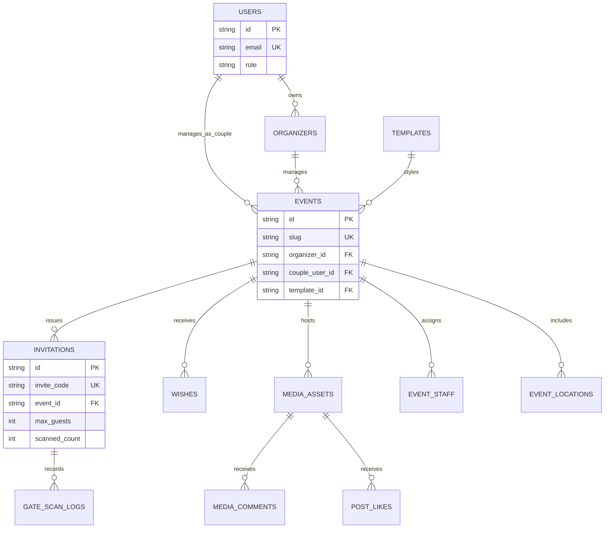

# Agafari Database Specification & Schema (MySQL 8.0+)

**Document Version**: 2.0  
**Engine**: MySQL 8.0+ / MariaDB (InnoDB, `utf8mb4_unicode_ci`)  
**ORM / Client**: `mysql2` connection pool with parameterization  

---

## 1. Mermaid Entity-Relationship Diagram (ERD)

---

## 2. Table Catalog & Column Rationales

### 2.1 `users`
| Column | Type | Index | Rationale |
| :--- | :--- | :--- | :--- |
| `id` | VARCHAR(36) | PRIMARY | Unique user identifier (`usr_...`). |
| `email` | VARCHAR(255) | UNIQUE, `idx_users_email` | Session login email address. |
| `password_hash` | VARCHAR(255) | - | PBKDF2-SHA512 hashed password (`salt:hash`). |
| `role` | ENUM | `idx_users_role` | RBAC role (`SYSTEM_ADMIN`, `EVENT_ORGANIZER`, `BRIDE_GROOM`, `LIVE_STREAMER`, `GATE_SCANNER`, `GUEST`). |

### 2.2 `organizers`
| Column | Type | Index | Rationale |
| :--- | :--- | :--- | :--- |
| `id` | VARCHAR(36) | PRIMARY | Unique agency organizer ID (`org_...`). |
| `owner_user_id` | VARCHAR(36) | FK `fk_organizers_owner` | Foreign key referencing `users.id` (agency owner). |

### 2.3 `events`
| Column | Type | Index | Rationale |
| :--- | :--- | :--- | :--- |
| `id` | VARCHAR(36) | PRIMARY | Unique event ID (`evt_...`). |
| `slug` | VARCHAR(120) | UNIQUE, `idx_events_slug` | URL slug used for guest links (e.g. `sarah-and-john`). |
| `status` | ENUM | `idx_events_status` | Lifecycle status (`DRAFT`, `COMING_SOON`, `LIVE`, `COMPLETED`, `ARCHIVED`). |
| `event_date` | DATETIME | `idx_events_date` | Wedding date; used by `LockWindow` for 48h RSVP lock. |
| `template_customization_json` | JSON | - | Custom typography, primary color, and banner URLs overriding defaults. |

### 2.4 `invitations`
| Column | Type | Index | Rationale |
| :--- | :--- | :--- | :--- |
| `id` | VARCHAR(36) | PRIMARY | Unique invitation pass ID (`inv_...`). |
| `invite_code` | VARCHAR(50) | UNIQUE, `idx_invitations_code` | 12-char URL-safe random code signed into QR payload. |
| `max_guests` | INT | - | Maximum total headcount permitted for this invitation pass. |
| `scanned_count` | INT | - | **Non-obvious**: Integer tally (instead of boolean `is_scanned`) to support partial group arrival across multiple scans. |
| `is_scanned` | BOOLEAN | `idx_invitations_is_scanned` | Derived flag (`scanned_count >= max_guests`) for fast query filtering. |

### 2.5 `gate_scan_logs`
| Column | Type | Index | Rationale |
| :--- | :--- | :--- | :--- |
| `id` | VARCHAR(36) | PRIMARY | Audit record for every gate QR scan attempt. |
| `invitation_id` | VARCHAR(36) | FK `idx_gate_scan_logs_invitation` | References `invitations.id` on delete cascade. |
| `event_staff_id` | VARCHAR(36) | FK `idx_gate_scan_logs_staff` | Identifies which gate scanner staff user scanned the pass. |

---

## 3. Foreign Key Index Audit

Every foreign key column in the schema is backed by an explicit index to prevent table locks on updates:

- `organizers(owner_user_id)` → `idx_organizers_owner`
- `events(organizer_id)` → `idx_events_organizer`
- `events(couple_user_id)` → `idx_events_couple`
- `events(template_id)` → `fk_events_template`
- `invitations(event_id)` → `idx_invitations_event`
- `rsvps(event_id)` → `idx_rsvps_event_id`
- `wishes(event_id)` → `idx_wishes_event_id`
- `media_assets(event_id)` → `idx_media_event_id`
- `media_comments(media_id)` → `idx_comments_media_id`
- `gate_scan_logs(invitation_id)` → `idx_gate_scan_logs_invitation`
